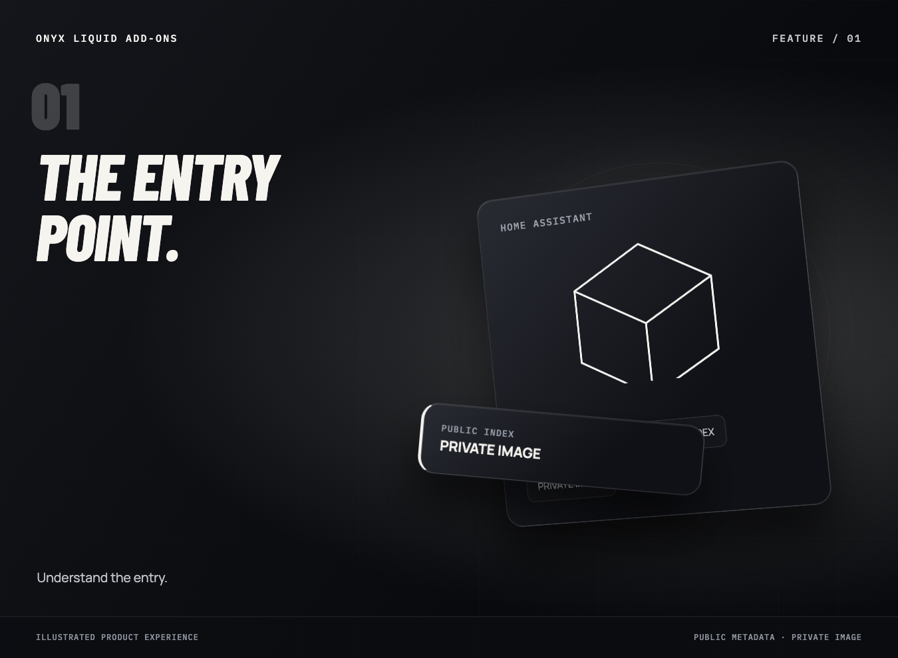
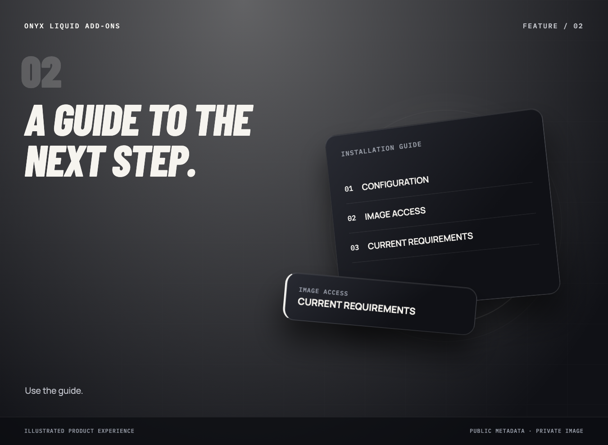
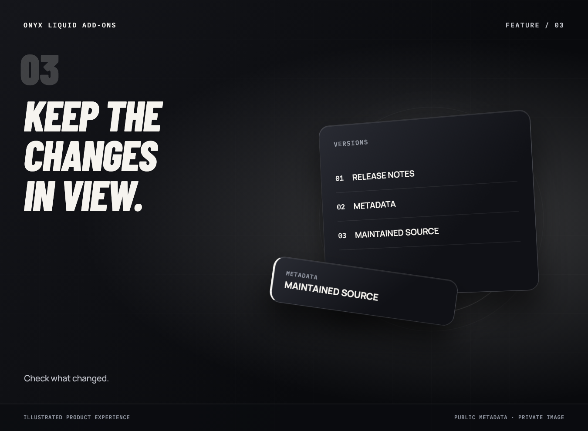
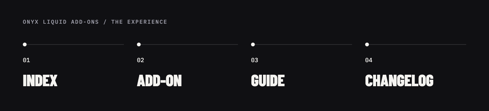
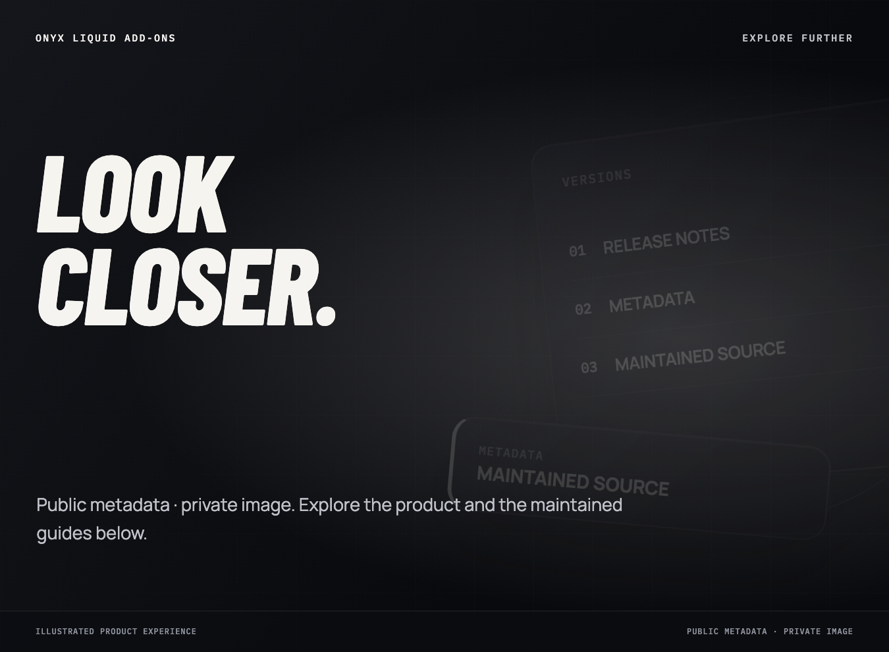

# Onyx Liquid Add-ons

The public Home Assistant add-on metadata index for the private Onyx Liquid image.

**Public metadata · private image.**

[Add-on guide](addons/navet/README.md) · [Changelog](addons/navet/CHANGELOG.md)

## A public index with a specific job

This repository gives Home Assistant a metadata entry point for the private Onyx Liquid add-on image. It is an index and a place to read the add-on’s documentation, not the image source or a public grant of access to the private registry.

**Who it is for:** A focused utility or experimental repository, with its technical reference available for the people using or maintaining it.

## What the experience brings

### Understand the entry

Read the repository metadata and add-on description.

### Use the guide

Follow the add-on’s README for the documented setup and behavior.

### Check what changed

Use the add-on changelog as the versioned record.

## From the first step to the next one

1. **Index.** Read the repository metadata and add-on description.
2. **Add-On.** Follow the add-on’s README for the documented setup and behavior.
3. **Guide.** Use the add-on changelog as the versioned record.
4. **Changelog.** Read the preserved technical reference for the full operating details.

## A focused workflow

A focused utility keeps its input, controls, and result understandable. The technical reference holds installation, configuration, supported inputs, operating controls, and limitations where those are documented.

## Availability

Use the versioned source and technical reference for current behavior and setup. Installation and operating details stay close to the source.

## Explore further

- [Documentation wiki](https://github.com/dmphx/onyx-liquid-addons/wiki)
- [Add-on guide](addons/navet/README.md)
- [Changelog](addons/navet/CHANGELOG.md)
