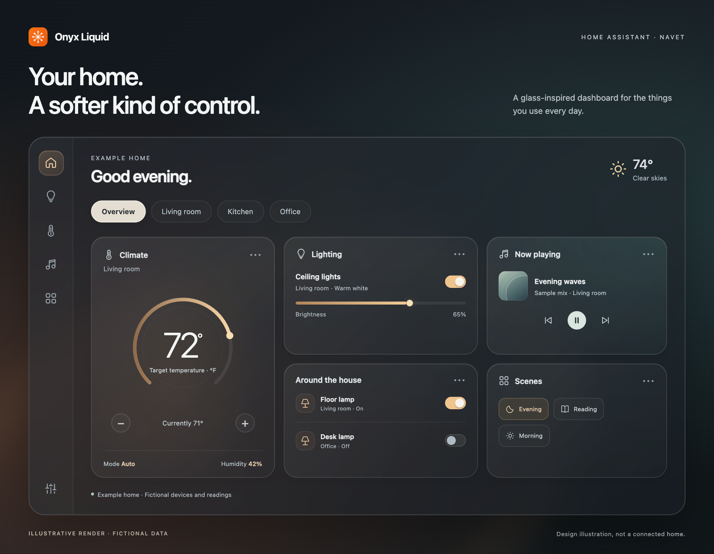

# Onyx Liquid

**A Liquid Glass take on the Home Assistant dashboard.**

Onyx Liquid is a custom version of **Navet**, with translucent panels, soft highlights,
and a dashboard you can arrange around your home. It runs as a Home Assistant add-on
and opens from the **Onyx Liquid** sidebar panel.

*Illustrative render with fictional rooms, devices, readings, and media. This is a
design illustration, not a screenshot of a connected home.*

## Make it your dashboard

- **Open it inside Home Assistant.** The add-on uses Home Assistant Ingress, so the
  dashboard is available from the sidebar.
- **Start with your own layout.** Set up Navet in the interface, or import a Navet
  dashboard YAML export on first launch in a fresh browser.
- **Keep your layout across browsers.** Dashboard changes are saved in the add-on's
  data directory and shared with other browsers using the same instance.

## What this repository provides

This is the public **add-on catalog and documentation** for Onyx Liquid. It gives
Home Assistant the name, version, image location, and configuration schema needed
to list the add-on.

The application is delivered as a prebuilt image in a **private Gitea registry**.
Application source, build files, and private household configuration are not
published here.

## Installation and access

You need **Home Assistant with add-on support on amd64** and **authorized access to
the private image registry**. Adding this public repository does not grant image
access; Home Assistant Supervisor needs an authorized registry credential to
install or update the add-on.

Once registry access is configured, add the repository, install **Onyx Liquid**,
and follow the [add-on guide](addons/navet/README.md) to connect Home Assistant and
configure your dashboard.

[Add-on guide](addons/navet/README.md) · [Changelog](addons/navet/CHANGELOG.md) · [Documentation wiki](https://github.com/dmphx/onyx-liquid-addons/wiki)

Built on Navet. Packaged and styled for Onyx.
